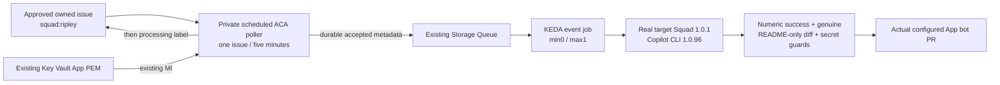

# Owned hosted runtime: private issue polling

This MIT fork credits [@haflidif](https://github.com/haflidif) and preserves the
original copyright. It changes our independently owned Apps/Jobs demo, not
Haflidi's original working deployment or native ACA Sandboxes.

## Current pipeline: no runner registration or new App permissions



The poller uses the existing UAMI and Key Vault App key, signing a short JWT
inside the container. Its target-restricted installation token requests only
Issues: write, Contents: read and Pull requests: read. Expired or unexpectedly
Administration-enabled responses are rejected. No Copilot credential is read by
the poller. Protected HTTP headers travel on stdin, never argv or ARM metadata.

Public configuration fixes the target repository, issue number and agent; the
poller reads only that issue, not an arbitrary issue search. Closed/unlabeled,
processing/attempted/queued, existing branch and existing PR cases do not enqueue.
A nonempty queue defers the poll without purging or modifying pending work.
Permission/read failures are errors, not evidence that a branch or PR is absent.

Only accepted queue writes precede `squad:processing`. The message contains
issue/agent/repository/source metadata, not issue body, title, credentials or a
prompt. It has a 600-second TTL and ten-second initial visibility delay.
Queue write failure or uncertain acknowledgement never marks processing.
If label acknowledgement fails or the worker wins the cross-service race,
the worker can claim only this expressly configured poller issue. With the
accepted event-job max1 it sets `squad:attempted` before native work, so sequential
duplicate messages cannot rerun an already attempted issue. Failed work keeps
its claim for explicit repair/retry; no automatic success or fallback PR.
Storage/GitHub are not one transaction; this is guarded at-least-once handoff,
not a claim of universal exactly-once delivery under arbitrary concurrency.

The poller runs under a 50-second process deadline and 60-second ACA replica
timeout, zero retries, one replica, on a five-minute UTC schedule. A required
UTC cutoff prevents authentication/queue activity after the accepted window.
Scheduled ticks still incur small runtime overhead after that cutoff, so the
accepted cleanup plan must retire the schedule through the same reviewed IaC;
the cutoff is not a substitute for schedule retirement or cost accounting.

## Genuine native work and protected publication

The worker keeps the existing protected App/Copilot split. Pinned Copilot CLI
1.0.96 runs `--agent Squad -p` from the current target default-branch clone.
The tracked genuine Squad profile and team must exist, and the target's native
setup checker must pass. No profile or team is synthesized. The configured App
slug/ID and actual bot user metadata bind commit identity to the owned App.

Every worker message, including historical `workflow` and revision messages,
must match the configured repository, issue number and agent. The caller's
`source` field is not authority. Current GitHub state must be OPEN and contain
the exact configured `squad:{agent}` approval before clone, before native work
and immediately before push. Processing/attempted/queued labels are only
lifecycle markers: they never authorize closed or withdrawn work. Attempt dedup
applies regardless of source. A revision additionally requires the open,
same-repository, actual-App-bot PR with the exact issue branch/head/base.

The owned worker supports only README publication. After native success it
ignores the entire model Git directory, including commits, messages, tags,
replace refs, remotes, configuration and hooks. It creates a fresh controlled
publisher, fetching only the qualified main ancestry from the fixed configured
target URL. Main movement fails closed. Final files are compared against the
qualified tree; only regular, size-bounded UTF-8 README bytes may differ.
Known credentials and token/PEM patterns are checked in the complete byte
content, not merely an endpoint diff. Git plumbing imports those bytes without
filters and creates one constant-message commit with actual App-bot metadata
and exactly one qualified parent. Only that explicit commit/ref is pushed,
with a branch-head lease and no tags; model history is never transferred.
Revisions qualify every previous non-main commit as single-parent,
README-only, constant-message App-bot history before native execution.
Untrusted legacy PR history requires independent operator review, not a reset
or automatic overwrite. These are publication boundaries, not an OS sandbox.

Copilot's licensed credential and MI header secrets are stripped from shell/MCP
child environments. Raw model/tool output, CLI logging and remote export are
disabled. Direct Azure/GitHub/curl/wget/push tools are denied; the wrapper owns
publication. Git hooks and external diff drivers are disabled.
Missing agent/setup, nonzero native exits, empty/state-only changes, binary or
out-of-scope README work, and known credential/PEM/token content cannot push or
open a PR. Issue/review JSON is untrusted task data, not expanded authority.
These controls do not replace an OS sandbox, trusted repository instructions
or the existing private egress policy.

## Optional historical GitHub Actions path

`agents/workflows/squad-queue.yml` remains the upstream workflow template for
deployments where that original transport is qualified. `agents/runner/` remains
an optional protected registration implementation, not part of this owned
poller deployment, source gate or image publisher. Its registration permission
requirements are deliberately not applied to the current App.

After independent source acceptance, normally review/merge
`agents/workflows/squad-queue-retired.yml` as the owned target's existing
`.github/workflows/squad-queue.yml`. It removes issue-triggered enqueue and
self-hosted runner dependence while retaining a credential-free manual status.
Cancel only the known old queued run after its zero-step binding is rechecked.
Do not close the smoke issue, purge its queue, change native assets or dispatch
another smoke. The optional revision template is unchanged.

## Real container build without host or Azure credentials

```powershell
python -m unittest discover -s tests -p "test_*.py" -v
```

CI runs executable synthetic Azure/GitHub/Copilot fixtures and real local Git
publication tests. Intermediate dummy credential blobs, credential commit
messages, wrong model ancestry and malicious model hooks/remotes are tested
against all received destination objects, not just README endpoints.
Approval withdrawal and scope spoofing execute the production worker.
A separate Ubuntu job builds the actual shared base/worker/poller
runtime using explicit public upstream Go/Debian base-image references, no Azure
credentials or private inputs, and no push. It tests installed CLI/tooling,
both installed entrypoints, expired-window poller startup and fail-closed worker
startup. The worker and poller use the same image with different entrypoints.
No Windows Docker service, daemon, license or OS feature is changed.

Private publishing remains a separate gate. The owned ACR is private; public
Ubuntu reachability and inherited original OIDC credentials are not assumed.
Read-only qualification found no existing ACR Task or private agent pool.
A qualified existing private publisher or accepted owner-authenticated trusted
ACR transient build path must be established using existing authority before
any image push. No standing pool, network opening, new role or App permission
is proposed. Credential-free CI build success is not a private push receipt.

## Focused existing-job IaC and live receipt

`infra/bicep/owned-runtime.bicep` preserves the upstream Jobs API version and
reuses the exact existing environment, registry, queue, UAMI and Key Vault.
It repurposes the broken owned runner Job ID as the poller, updates the separate
worker, preserves supplied tags/workload profile and adds no network/IAM/storage
resource. Explicit ordering updates the trusted worker before enabling polling.
The old job being user-created and untagged does **not** prove it has no Terraform
owner. Exact baseline, state ownership, existence and what-if remain mandatory.
If ownership forbids repurposing, stop and qualify a separately reviewed minimal
alternative; do not silently create a duplicate resource or become a second writer.

Existing MI role metadata proves queue add through Message Sender, peek through
Data Reader, processing through Message Processor, protected reads through
Secrets User, and ACR pull/push. It does not prove live secret access, licensing
or publishing connectivity. Caller Key Vault denial is not a job-MI failure.

Only after source review, immutable images, target workflow retirement,
state/baseline, policy, cost and `azure-validate` acceptance may `azure-deploy`
change these two exact jobs. Record the sole existing issue → exact poller
execution → durable queue handoff → exact event worker → numeric native return →
actual bot README diff/commit PR. No fallback or native-sandbox substitution.

One admitted poller iteration at 0.25 vCPU/0.5Gi for at most 60s plus one worker
at 1 vCPU/2Gi for at most 600s gives a conservative **615 vCPU-seconds and
1,230 GiB-seconds** workload ceiling, excluding builds/log/storage and other
scheduled ticks. Reserve the actual regional cost under the tenant cap.
Supervise for at most 600s and stop only newly recorded exact executions; retire
the accepted poll schedule through reviewed IaC rather than stopping all jobs.

**Status:** source preparation and credential-free build verification only.
No live poller, queue mutation, App permission change or genuine hosted PR is
claimed before the deployment gates pass.
